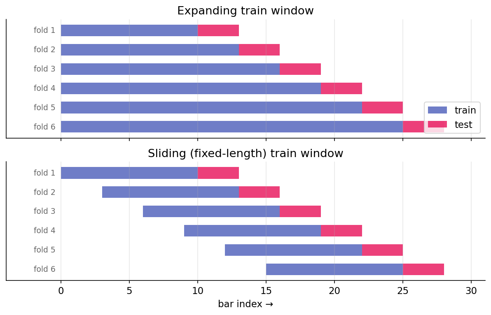

# You cannot stand in tomorrow

*You cannot stand in tomorrow. Only in yesterday, looking forward. Again. And again. Each fold a small truth, each test fold strictly after its training.*

A backtest answers a counterfactual: if this strategy had been deployed at time $t$, knowing only what was available then, how would it have performed? The standard tool is cross-validation. The default machine-learning approach — random k-fold — fails silently on time series. Walk-forward is the correction.

## Why naive k-fold is wrong

Standard k-fold cross-validation shuffles the dataset, splits into $k$ folds, trains on $k-1$ folds, tests on the held-out fold. The procedure assumes iid data.

Financial time series are not iid. Two failure modes:

1. **Temporal leakage.** Shuffled k-fold places training data from after the test fold's wall-clock time into the training set. A model trained in this configuration has access to future information.
2. **Regime mixing.** Markets alternate between regimes. Randomly sampling across regimes in both training and test folds causes the model to learn a regime-average rather than a regime-specific response.

*A k-fold Sharpe on a trading strategy can be twice the live-trading Sharpe on the same signal. The difference is temporal leakage, presented as out-of-sample evidence.*

## The walk-forward procedure

Walk-forward respects time order. At each step:

1. Train on data from the start through time $t$ (or from $t - \text{window}$ through $t$).
2. Test on data from $t$ to $t + h$.
3. Advance $t$ by a stride and repeat.

Pictorially, with `initial_train = 10`, `test_horizon = 3`, `stride = 3`, comparing the two train-window variants:

{ loading=lazy }

*Every test fold is strictly after its training fold. No temporal leakage. Each test observation answers: what would this model have said about this period, given only what was available before it?*

## Expanding versus sliding

Two common variations:

- **Expanding**: train window grows with each step. More data; old regimes accumulate weight.
- **Sliding**: train window has fixed length $W$. Adaptive to regime changes; less data per step.

For a strategy whose edge is stationary, expanding wins. For a regime-dependent edge, sliding. When unclear, run both.

## Stride and overlap

The stride controls how far the anchor advances between folds. Stride equal to test horizon ($s = h$) produces non-overlapping test folds — simplest, most defensible. Stride less than horizon produces overlapping test folds; these appear to add observations but do not yield independent ones.

## Walk-forward as outer loop

Walk-forward is the outer evaluation loop. Inside each fold, model selection may require its own cross-validation.

A standard protocol:

1. Walk-forward defines the outer train-test splits.
2. Within each outer train set, purged k-fold selects hyperparameters.
3. Retrain on the full outer train set using the selected hyperparameters.
4. Evaluate on the outer test fold.
5. Advance the walk-forward anchor.

*Violating this structure — using the outer test fold to select hyperparameters — introduces subtle look-ahead that will not survive in live trading.*

## What walk-forward does not prevent

Walk-forward catches temporal leakage but leaves other biases unaddressed:

- **Label-horizon leakage.** A training label at time $t$ that depends on prices through $t + 5$ can overlap the test fold even when $t$ itself is in the train set. Purging ([next lesson](purging-embargo.md)) is the correction.
- **Data-snooping bias.** Walk-forward evaluates a single strategy. If 100 were tried and this one selected, the test performance is biased by selection. Walk-forward does not track $N$. [Deflated Sharpe](deflated-sharpe.md) is the correction.
- **Forward-looking features.** Features computed from future data leak regardless of cross-validation scheme.
- **Survivorship bias.** Running a backtest on today's index constituents excludes companies that went bust.

*Walk-forward is necessary but not sufficient. It catches the most common leakage — temporal — but not the subtler forms.*

## Expanding-train estimator noise

Expanding-train walk-forward produces small training sets in early folds. Fold 1 may have 252 observations; fold 20 may have 1,512. Early-fold model quality is worse not because the strategy has no edge, but because the estimator is noisy.

This biases the cumulative out-of-sample Sharpe downward in early folds. As training data grows, bias diminishes. Realized backtest performance improves over time even when the edge is stationary.

*Do not mistake this for a strengthening edge. It is the estimator becoming less noisy.*

## Summary

- Random k-fold cross-validation produces optimistic Sharpes on time series because shuffling grants training data access to the future.
- Expanding and sliding train windows are appropriate under different conditions: stationary edge versus regime-dependent edge.
- Walk-forward catches temporal leakage but not survivorship bias, data snooping, or forward-looking features.

## Implemented at

`trading/packages/harness/src/harness/backtest.py`:

- Line 22: `WalkForwardConfig(initial_train, test_horizon, stride, expanding=True)`.
- Line 40: `WalkForward.split(n_samples)` — generator yielding `(train_idx, test_idx)` pairs.

The module docstring is explicit: `WalkForward does NOT execute the strategy — it yields index pairs. The caller trains, predicts, and computes PnL per window`. This separation keeps the harness agnostic to model type, feature construction, and cost modeling.

---

*You cannot stand in tomorrow. Only in yesterday, looking forward. Again. Next: what a label reaches for, without meaning to.*

**Next:** [What a label reaches for →](purging-embargo.md)
