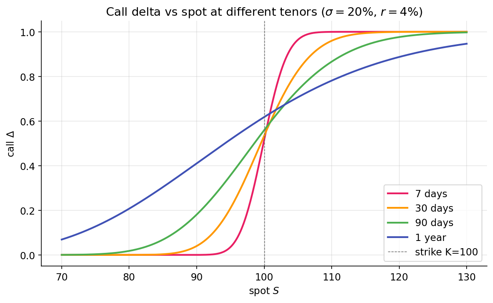

# How much does the door move

*When the wind shifts, the door moves. Not by the whole of the wind. Only some of it. And we ask, quietly: this much? This much.*

*We call the answer delta.*

The Black-Scholes derivation produced a hedging portfolio $\Pi = C - \Delta S$ whose first-order risk cancels. The coefficient $\Delta$ — the partial derivative of option value with respect to the underlying — simultaneously describes exposure, hedge ratio, and an approximate probability of exercise.

## Definition

$$
\Delta = \frac{\partial V}{\partial S}.
$$

Delta is the dollar change in an option's value per $1 change in the underlying. It is a rate evaluated at a specific $S$, valid for small moves. For a European call under Black-Scholes:

$$
\Delta_\text{call} = N(d_1),
$$

so $\Delta \in (0, 1)$. For a European put, by put-call parity:

$$
\Delta_\text{put} = N(d_1) - 1 = -N(-d_1),
$$

so $\Delta \in (-1, 0)$.

A call's price rises with the underlying, so its delta is positive. A put's price falls with the underlying, so its delta is negative.

## Three regimes

### Deep ITM: $\Delta \to \pm 1$

*Near certainty, the option walks beside the stock. Step for step.*

When a call's strike is well below current spot and expiry is near, the option is almost certain to finish ITM. Its value at expiry equals $S_T - K$, which moves dollar-for-dollar with $S_T$, so $\partial V / \partial S$ approaches 1. A deep-ITM call behaves like stock net of a fixed obligation.

For a deep-ITM put, $\Delta \to -1$.

### Deep OTM: $\Delta \to 0$

*Far from the strike, the option ignores the wind.*

When a call is far out of the money and near expiry, small moves in $S$ have little effect on the probability of finishing ITM, and $\partial V / \partial S$ approaches zero.

### ATM: $\Delta \approx 0.5$ for a call, slightly above

When $S = K$ with time remaining, the call has approximately a 50% risk-neutral probability of finishing ITM, and delta is approximately 0.5 — though not exactly. For a call with positive time and non-zero vol, $d_1 > d_2$, so $N(d_1) > N(d_2)$. An ATM call's delta typically sits in 0.52–0.55. The offset reflects the asymmetry of upside versus downside payoffs.

*Across a range of spot and at several tenors, the three regimes form one smooth curve:*

{ loading=lazy }

## Delta as hedge ratio

The Black-Scholes derivation produces this directly: the portfolio $\Pi = C - \Delta S$ is locally riskless. A long call's exposure to the underlying equals that of $\Delta$ long shares; shorting $\Delta$ shares neutralizes the first-order exposure.

*A worked example. A market maker's position.*

Ten SPY calls, strike $\$450$, 30 days to expiry, SPY at $\$450$. Each contract covers 100 shares. Call delta at these parameters is 0.53.

- **Position delta:** $10 \text{ contracts} \times 100 \text{ shares/contract} \times 0.53 = 530$ share-equivalents.
- **Delta hedge:** short 530 shares of SPY.
- **Net position:** approximately delta-neutral. P&L is near zero for small moves.

*Delta-neutral is not profit-neutral. It is first-order neutral. Gamma remains. Theta eats at the premium. The whole point of the hedge is to isolate those second-order effects — to hold the option still enough to trade the vol beneath it.*

## Delta as approximate probability

Traders often describe delta as the probability of finishing ITM. The description is approximate:

$$
\Delta_\text{call} = N(d_1), \qquad \mathbb{P}(S_T > K \mid \text{risk-neutral}) = N(d_2), \qquad d_1 - d_2 = \sigma \sqrt{T}.
$$

$\Delta$ equals the probability only in the limit of zero volatility or zero time. For a 30-day option with $\sigma = 20\%$, $\sigma \sqrt{T} \approx 0.058$, and the gap is small. For LEAPS, $\sigma\sqrt{T}$ can exceed 0.4, and delta can overstate exercise probability by several percentage points.

*A useful lie for short-dated options. A less useful one for the long-dated.*

## Delta-one products

Instruments that move one-for-one with the underlying have $\Delta = 1$: the underlying itself, futures (subject to cost-of-carry), tracking ETFs (within tracking error). "Delta-one" desks at banks trade these products — baskets and swaps whose risk profile is purely directional, with no convexity.

A covered call (long 100 shares + short 1 call) has net delta $100(1 - \Delta_\text{call})$: reduced upside exposure, retained downside until the call expires.

## Delta is not constant

*The door moves differently at different spots. The hinge is not a point. It is a curve. We will call the curve gamma.*

Delta is a function of $S$, $t$, and $\sigma$. The next lesson develops the most important of delta's own sensitivities. A delta hedge correct at $t_0$ is no longer correct at $t_0 + dt$. The accumulated P&L of a delta-hedged position is not zero; it depends on realized versus implied volatility.

## Summary

- Deep-ITM calls move like stock and deep-OTM calls are nearly insensitive; delta varies smoothly from 0 to 1.
- A market maker neutralizes directional risk on a quoted call using a single number.
- "Delta ≈ probability of ITM" is usable shorthand for short-dated options and fails for long-dated ones as the $\sigma\sqrt{T}$ gap between $N(d_1)$ and $N(d_2)$ widens.

## Implemented at

`trading/packages/gex/src/gex/greeks.py:52` — `bs_delta_call(spot, strike, rate, sigma, tenor_years)` returns $N(d_1)$, vectorized. Used in the 25-delta skew computation ([Part IV](../vol-surface/skew.md)): given a target delta like $0.25$, the skew module finds the strike whose call has that delta and reads the IV there.

---

*How much does the door move. Next: what shape the hinge traces.*

**Next:** [The hinge, and its curvature →](gamma.md)
