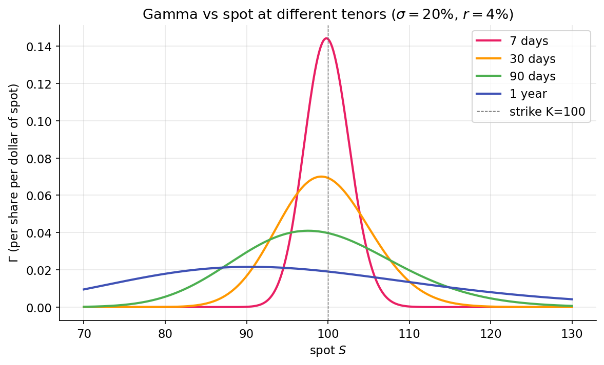

# The hinge, and its curvature

*Delta tells us how much the door moves. Gamma tells us how that movement changes. The hinge, the hinge — was it true? Is it bending? Are we standing in the doorway, or passing through?*

Delta measures an option's exposure to the underlying. Gamma measures delta's own sensitivity to the underlying. Two consequences follow: a hedge set at time $t$ is inexact by $t + dt$, and the rate at which it becomes inexact is itself a tradable quantity. Dealer positioning and market regimes in Part V follow from this structure.

## Definition

$$
\Gamma = \frac{\partial \Delta}{\partial S} = \frac{\partial^2 V}{\partial S^2}.
$$

Gamma measures how much delta changes per $1 move in the underlying. It is non-negative for long options because the payoff is convex in $S$.

Under Black-Scholes:

$$
\Gamma = \frac{\phi(d_1)}{S \sigma \sqrt{T}},
$$

where $\phi$ is the standard normal PDF. Gamma is identical for a call and a put at the same strike and expiry: put-call parity makes their deltas differ by 1, but their second derivatives are equal. The GEX pipeline uses a single `bs_gamma` regardless of contract type.

## When gamma is large

Three factors:

1. **Moneyness.** $\phi(d_1)$ peaks when $d_1 = 0$ (approximately when $S = K$). ATM options have the highest gamma. Deep ITM or OTM options have low gamma.

2. **Time to expiry.** The $\sqrt{T}$ in the denominator produces rapidly growing gamma as expiry approaches. A 30-day ATM call has moderate gamma; a 1-day ATM call has much larger gamma — delta oscillates between near-0 and near-1 as spot crosses the strike on expiry day. This is pin risk.

3. **Volatility.** The $\sigma$ in the denominator means gamma is higher when implied volatility is lower. Low $\sigma$ concentrates gamma near the strike; high $\sigma$ diffuses it across a wider range.

{ loading=lazy }

*The ratio between the 7-day and 1-year peaks at the money is $\sqrt{365/7} \approx 7.2$. The $1/\sqrt{T}$ scaling, made visual.*

## P&L of a delta-hedged position

*Delta cancels. What remains is gamma and theta, standing opposite each other.*

Consider a position long one call, hedged short $\Delta$ shares. Over a small time $dt$ during which the underlying moves by $dS$:

$$
d\Pi \approx \underbrace{\Theta\, dt}_{\text{time decay, negative}} \;+\; \underbrace{\tfrac{1}{2} \Gamma\, (dS)^2}_{\text{gamma, non-negative}}.
$$

Where did the delta terms go? They cancelled, as designed.

Two observations:

- Gamma P&L is non-negative: $(dS)^2 \ge 0$, $\Gamma \ge 0$. Every price move contributes positively.
- Theta P&L is non-positive for long options: time decay erodes value whether or not the underlying moves.

A hedged option holder earns from realized volatility and pays through time decay. The break-even:

$$
\tfrac{1}{2} \Gamma\, (dS)^2 = -\Theta\, dt \quad\Longrightarrow\quad \left(\frac{dS}{S}\right)^2 \approx \sigma_\text{implied}^2\, dt.
$$

*The option's implied volatility is the volatility at which the hedged position has zero expected P&L. When realized exceeds implied, long gamma profits. When realized falls short, long gamma loses. This is the fulcrum. Every options book pivots on it.*

## Gamma scalping

A long-volatility position rebalanced regularly earns through mechanical buying at low prices and selling at high:

- At $S_0$, 1 long call with delta $\Delta_0$; short $\Delta_0$ shares.
- Stock moves to $S_1 > S_0$. Call's delta is now $\Delta_1 > \Delta_0$ (via gamma). Portfolio is under-hedged.
- Rehedging requires shorting additional shares at $S_1$.
- Stock returns to $S_0$. Delta falls back to $\Delta_0$. Portfolio is over-hedged.
- Rehedging requires buying back shares at $S_0 < S_1$.

*Sell high, buy low. Not by intent. By geometry. The round trip captures realized variance.*

In the continuous-hedging limit, the position captures $\tfrac{1}{2}\Gamma (dS)^2$ per move, summed over the path — proportional to realized variance. The up-front cost is the call premium, eroded by the $\Theta$ term. Profit exists when realized variance exceeds what the premium priced in.

## Short gamma — the counterparty

*Someone sold you that call. They are short gamma. The path that produces positive scalp P&L for you produces equal-and-opposite negative P&L for them.*

Short-gamma positions profit from calm and lose from motion. Dealers who systematically sell options to retail and institutional customers are, on aggregate, short gamma. Each move costs them and induces hedging in the direction of the move — buying on strength, selling on weakness — which amplifies the move. This is the feedback loop covered in Part V.

## Scale — GEX in dollars per 1% move

Raw gamma has units of $\text{shares}/\$$. For regime analysis, the useful quantity is dollar hedging flow per 1% move:

$$
\text{\$GEX per 1\% move} = \Gamma \times \text{OI} \times \text{contract multiplier} \times S^2 \times 0.01.
$$

Two factors of $S$: one converts gamma from shares-per-dollar to dollars-of-hedge-per-dollar; the second converts a 1% move from dollars to a fraction of spot. Open interest and contract multiplier scale to the aggregate position.

`packages/gex/src/gex/gex.py` reports GEX in these units. The regime logic in [the gamma-flip lesson](../regime/gamma-flip.md) operates on this aggregated quantity.

## Summary

- Gamma is identical for calls and puts of the same strike: the second derivative depends on the payoff shape, and call/put payoffs share it.
- Short-dated ATM options have very high gamma: $\sqrt{T}$ in the denominator grows as expiry approaches.
- Implied volatility is operationally the break-even vol for a delta-hedged position — long gamma profits when realized exceeds implied.

## Implemented at

`trading/packages/gex/src/gex/greeks.py:31` — `bs_gamma(spot, strike, rate, sigma, tenor_years)` returns $\phi(d_1) / (S \sigma \sqrt{T})$, vectorized. A single function handles calls and puts. It is used in `packages/gex/src/gex/gex.py:per_strike_gex`, which multiplies by OI, multiplier, $S^2$, and $0.01$ to produce the $\text{\$GEX per 1\%}$ quantity of Part V.

---

*The hinge curves. The door moves differently at different spots. Next: time, fear, rates.*

**Next:** [Time takes, fear rises →](theta-vega-rho.md)
