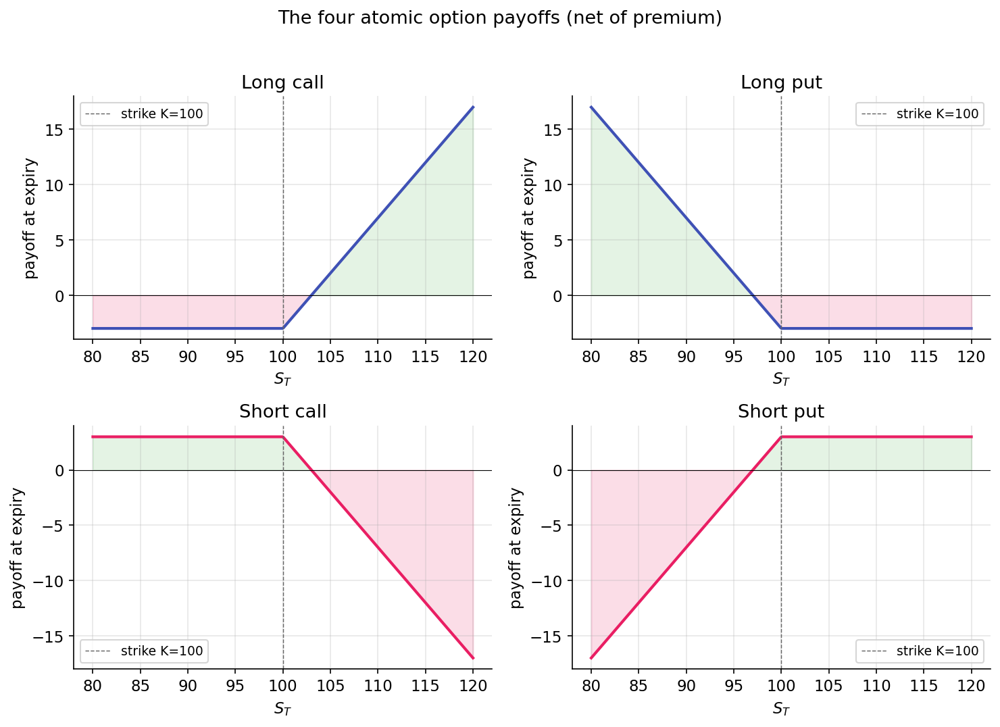

# A promise you need not keep

*There is a kind of contract that binds only one of the two who sign it. One may walk away. The other must stand there, whatever the weather.*

*We call it an option.*

## Definition

An **option** is a contract granting its *holder* the right — but not the obligation — to buy or sell a specific asset at a specific price by a specific date.

Four components:

| Term | Meaning |
|------|---------|
| **Underlying** | The asset the contract references (a stock, ETF, index, or commodity). |
| **Strike** $K$ | The agreed transaction price. |
| **Expiry** $T$ | The date the right lapses. |
| **Premium** | The price the buyer pays the seller upfront for the contract. |

Two types:

- A **call option** conveys the right to buy the underlying at $K$.
- A **put option** conveys the right to sell the underlying at $K$.

Each contract has two sides: the **holder** (who paid the premium and owns the right) and the **writer** (who received the premium and assumes the obligation).

*The holder can walk away. The writer cannot. This is the whole story.*

## The asymmetric right

A holder who owns the right to buy at $K = \$100$ will:

- Exercise if the underlying is above $\$100$ at expiry (buying at $\$100$ and selling at market captures the spread).
- Decline to exercise if the underlying is below $\$100$ (there is no reason to buy at $\$100$ what the market offers at a lower price).

The holder's worst outcome is the forfeiture of the premium. The loss is bounded. The writer's best outcome is also the premium — kept in full if the holder declines to exercise. The writer's potential loss is not bounded.

*One gives up a small, known thing. One takes on a small, known thing — and, should the weather turn, an unknown thing beside it.*

A consequence: **options always have non-negative value**. The right to act, plus the right to decline, is worth at least zero. A deep-OTM contract near expiry may trade for a few cents but cannot trade at a negative price.

## Payoff at expiry

At expiry, time value, implied volatility, and hedging considerations are no longer relevant. The payoff is mechanical.

**Long call** on an underlying trading at $S_T$, struck at $K$:

$$
\text{Payoff}_\text{call} = \max(S_T - K, 0).
$$

**Long put:**

$$
\text{Payoff}_\text{put} = \max(K - S_T, 0).
$$

**Short call** (written rather than purchased):

$$
\text{Payoff}_\text{short call} = -\max(S_T - K, 0).
$$

The loss is unbounded if the underlying rises. Naked short calls are among the highest-risk positions in standard options trading.

**Short put:**

$$
\text{Payoff}_\text{short put} = -\max(K - S_T, 0).
$$

The loss is bounded by $K$ (a stock can reach zero but not go negative) but can be substantial.

*Draw them. Payoff on the vertical. Terminal price on the horizontal. Four hockey sticks. Nothing else to remember, at the terminus.*

{ loading=lazy }

Complex positions (spreads, straddles, butterflies) are sums and differences of these four shapes. The next lesson develops composites.

## Intrinsic value and time value

Before expiry, an option trades at some premium $P$. The premium decomposes:

$$
P = \underbrace{\max(S_t - K, 0)}_{\text{intrinsic}} + \underbrace{P - \text{intrinsic}}_{\text{time value}} \qquad \text{(for a call).}
$$

**Intrinsic value** is the payoff from immediate exercise (ignoring premium paid). Positive for ITM options; zero for OTM or ATM options.

**Time value** reflects the possibility that the underlying may move favorably between now and expiry — the value of remaining optionality. It is largest for ATM options and collapses to zero at expiry, fastest in the final days. This decay has a name: **theta**, covered in Part III.

*Time value is a kind of hope. It erodes, whether or not the world obliges.*

A call 10% ITM with a month to expiry may trade at \$11 when its intrinsic value is \$10: \$10 intrinsic plus \$1 time value. Held to expiry with the underlying unchanged, time value collapses to zero; the option trades at \$10.

## Moneyness and leverage

"Moneyness" describes the position of the strike relative to the underlying:

- **ITM** (in the money): call with $S > K$ or put with $S < K$. Intrinsic value positive.
- **ATM** (at the money): $S \approx K$. Maximum time value, maximum gamma (Part III).
- **OTM** (out of the money): call with $S < K$ or put with $S > K$. Intrinsic value zero; entire premium is time value.

OTM options trade at lower premiums because their payoff requires a meaningful move. A \$2 OTM call on a \$100 stock requires an approximately 10% move to finish ITM by expiry. If the move occurs, the position may appreciate substantially; if not, the premium is forfeited entirely.

*A small bet on a large hope. This is why people buy them. It is also why, in aggregate, the sellers profit.*

## American and European, cash and physical

Two mechanical distinctions:

- **American options** permit exercise at any time before expiry. Single-name U.S. equity options (AAPL, TSLA) are American.
- **European options** permit exercise only at expiry. Cash-settled index options (SPX) are European.

European options are simpler to price: Black-Scholes produces a closed-form solution. American options introduce the optimal-exercise problem, which for calls on non-dividend-paying stocks is trivial (exercise is never optimal early). For puts and for calls on dividend-paying stocks, early exercise is occasionally optimal. The resulting pricing difference (American ≥ European at matched strike and expiry) is typically small.

**Settlement** determines whether the underlying is delivered physically or exchanged in cash. Single-name equity options settle physically; index options settle in cash.

## Summary

Options pricing reduces to: given the underlying's price, volatility, time to expiry, and risk-free rate, what premium is consistent with the payoff at expiry? The payoffs above are the terminal condition. The remainder of Part II builds a consistent present price:

- [Shapes, and the equation beneath them](payoffs-and-parity.md) — the no-arbitrage equation linking calls, puts, stock, and cash.
- [Three men, one formula](black-scholes.md) — a closed-form premium under the GBM assumption from Part I.

By the end of this lesson:

- Every option has non-negative premium: the right to act plus the right to decline is worth at least zero.
- Deeper-OTM options have lower absolute premiums and higher leverage to moves that matter.
- Time value is concentrated near ATM and collapses fastest near expiry — the signature of theta.

## Implemented at

The trading project does not price options from scratch; it consumes quoted premiums and uses them to compute Greeks via `trading/packages/gex/src/gex/greeks.py`. The contract mechanics described here are what those quotes represent.

---

*A promise one may keep, or not. A door that stays open. Next: how doors fit together.*

**Next:** [Shapes, and the equation beneath them →](payoffs-and-parity.md)
