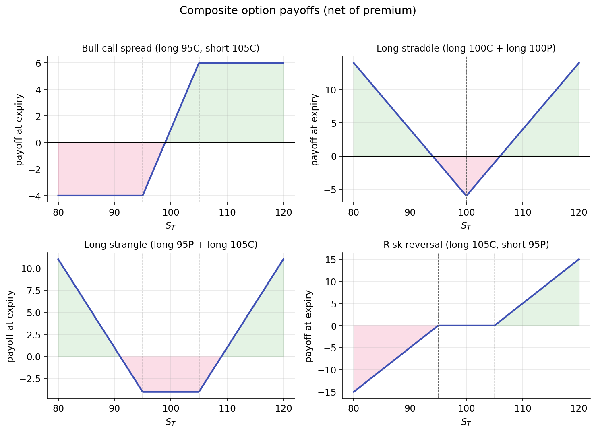

# Shapes, and the equation beneath them

*Four shapes, four hockey sticks, and from them every structure. Over and under them, a single equation, binding. Call it parity. It holds without model, without belief. It holds because two things cannot promise the same payoff and have different prices. That is all.*

Four atomic payoffs (long call, long put, short call, short put) compose into every structure on the options chain. Most complex-looking options positions are sums and differences of these four hockey-stick shapes.

One equation — put-call parity — relates the prices of calls, puts, the underlying, and cash. It holds regardless of the pricing model; violations imply arbitrage opportunities.

## Composing diagrams

The four single-leg payoffs from [the previous lesson](contracts.md), at expiry as a function of terminal price $S_T$:

- Long call: $\max(S_T - K, 0) - c$ (subtract premium paid)
- Long put: $\max(K - S_T, 0) - p$
- Short call: $c - \max(S_T - K, 0)$
- Short put: $p - \max(K - S_T, 0)$

*Every combination is a sum. Graphical addition is the fastest way to see what a position does.*

### Bull call spread (long $K_1$ call, short $K_2$ call, $K_1 < K_2$)

$$
\text{Payoff} = \max(S_T - K_1, 0) - \max(S_T - K_2, 0).
$$

| $S_T$ region | Payoff |
|--------------|--------|
| $S_T \le K_1$ | $0$ |
| $K_1 < S_T < K_2$ | $S_T - K_1$ |
| $S_T \ge K_2$ | $K_2 - K_1$ |

A bullish position with capped upside. Maximum profit is $K_2 - K_1$ minus net premium; maximum loss is the net premium. The structure exchanges unlimited upside for lower entry cost.

### Long straddle (long $K$ call + long $K$ put)

$$
\text{Payoff} = \max(S_T - K, 0) + \max(K - S_T, 0) = |S_T - K|.
$$

A V-shape centered at $K$. Profitable when $|S_T - K|$ exceeds combined premium.

*A bet that something will happen, and a willingness not to name what.*

### Long strangle (long $K_1$ put + long $K_2$ call, $K_1 < K_2$)

Similar to a straddle, wider strikes. Lower premium; larger move required for profitability.

### Risk reversal (long $K_\text{high}$ call + short $K_\text{low}$ put)

A payoff sloping upward across the entire price range — effectively synthetic long exposure, flat in the middle. Risk reversals express directional views while monetizing skew; on equity indices, the long-call / short-put construction often has near-zero net premium.

{ loading=lazy }

*These four are a starting set. Butterflies, iron condors, calendar spreads — all made of the same four lines.*

## Put-call parity — the equation without a model

The prices of a call and a put struck at the same $K$ and expiring at the same $T$ are not free parameters:

$$
C - P = S - K e^{-rT}.
$$

Here $C$ is the call price, $P$ the put price, $S$ the current underlying price, $r$ the risk-free rate, $T$ the time to expiry. $K e^{-rT}$ is the present value of the strike.

*No distributional assumption. No stochastic calculus. The equation holds because arbitrage would follow if it did not.*

Two points before the derivation:

1. This identity is not Black-Scholes. It does not assume GBM, log-normality, constant volatility, or any particular process for $S$.
2. It holds for European options. American options can deviate slightly due to early exercise; the deviation is typically small for non-dividend-paying stocks.

### Derivation by no-arbitrage

Consider two portfolios at time $t = 0$:

- **Portfolio A:** long one call plus short one put, both at strike $K$ and expiry $T$. Net price today: $C - P$.
- **Portfolio B:** long one unit of the underlying plus short $K e^{-rT}$ dollars of cash. Net price today: $S - K e^{-rT}$.

At expiry, both portfolios pay $S_T - K$ in every terminal state:

| $S_T$ region | Call pays | Short put pays | Sum |
|--------------|-----------|----------------|-----|
| $S_T > K$ | $S_T - K$ | $0$ | $S_T - K$ |
| $S_T < K$ | $0$ | $-(K - S_T) = S_T - K$ | $S_T - K$ |
| $S_T = K$ | $0$ | $0$ | $0 = S_T - K$ |

Portfolio B pays $S_T$ (the stock) minus $K$ (the repaid debt). Both portfolios pay the same amount in every state. If they paid the same in every state and had different prices today, shorting the more expensive and buying the cheaper would lock in a riskless profit. No-arbitrage therefore requires:

$$
C - P = S - K e^{-rT}.
$$

*Two portfolios with the same shadow must have the same body. That is the whole argument.*

## Parity's uses

### Synthetic positions

Rearranging parity allows synthesizing any one of the four instruments from the other three:

$$
\text{Long stock} = C - P + K e^{-rT}.
$$

A long call plus short put plus $K e^{-rT}$ in cash provides the same economic exposure as a long stock position, with matching P&L in every state. Institutional desks use this construction to replicate stock exposure when capital efficiency or margin rules favor it.

Analogously:

$$
C = P + S - K e^{-rT}, \qquad P = C - S + K e^{-rT}.
$$

### Parity as a data-integrity check

Parity violations in real data typically indicate one of three conditions:

1. Data errors (stale prices, one side from close, the other from last trade).
2. Frictions not in the equation (hard-to-borrow fees on short stock, early-exercise premium on American options, unaccounted dividends).
3. Genuine arbitrage — rare, short-lived, and typically eliminated quickly by market makers.

In practice, the parity equation catches more data errors than arbitrage opportunities.

*A sanity check. A way of asking the data: are you telling me the truth?*

### Dividends

If the underlying pays dividends with total present value $D_0 = \sum_i d_i e^{-r t_i}$ before expiry:

$$
C - P = S - D_0 - K e^{-rT}.
$$

The long-stock portfolio collects dividends; the synthetic long (calls minus puts) does not. Subtracting the present value of dividends corrects for the flow.

## Summary

- Options positions decompose into sums of single-leg payoffs; any strategy diagram can be characterized by inspection.
- A long stock position can be synthesized from a call, a put, and cash. Institutional desks use the synthetic when capital or margin rules favor it.
- Put-call parity is model-free and serves as a sanity check on any options dataset.

## Implemented at

Put-call parity is not an algorithm in the trading project; it is an invariant. Given a chain from `trading/packages/gex/src/gex/data/options.py` (the `YFinanceChainSource` or `PolygonChainSource`), computing $C - P - S + K e^{-rT}$ for each strike should yield values near zero. Deviations indicate data issues rather than signals.

---

*Two portfolios that promise the same payoff must cost the same today. All else, below, is elaboration. Next, a formula — three men at a table, a random walk, a price.*

**Next:** [Three men, one formula →](black-scholes.md)
