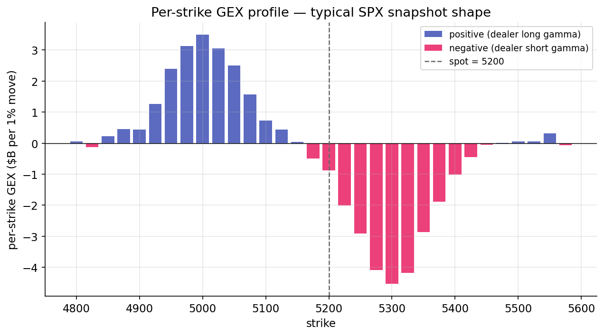

# When the engine breathes

*When the engine is long gamma, the tape is still. When the engine is short, the tape breathes — and the breath grows, feeding on itself. This is what we mean when we say regime.*

The market-makers lesson established the mechanism of dealer hedging. This lesson quantifies the magnitude. Aggregating gamma across every outstanding option, signed by dealer position, produces a single number summarizing the market's hedging regime — gamma exposure (GEX).

## Aggregation formula

For a single contract at strike $K$ with open interest $\text{OI}_K$ and implied volatility $\sigma_K$, the dealer's gamma position is:

$$
G_K = \text{sign}_K \cdot \Gamma_K \cdot \text{OI}_K \cdot \text{multiplier}
$$

where:

- $\Gamma_K$ is Black-Scholes gamma per share, from $S$, $K$, $\sigma_K$, $T$, $r$.
- $\text{OI}_K$ is open interest.
- $\text{multiplier}$ is the contract size (100 for standard U.S. equity options).
- $\text{sign}_K$ is the dealer-position sign: $-1$ for calls, $+1$ for puts.

$G_K$ has units of shares per dollar of spot move. Conversion to dollar hedging flow per 1% move:

$$
\text{GEX}_K = G_K \cdot S^2 \cdot 0.01.
$$

*The two factors of $S$ are not incidental. The first converts gamma from shares-per-dollar to dollars-of-hedge-per-dollar. The second converts a 1% move from dollars to a fraction of spot. The final $0.01$ is the 1% scaling.*

## Summing across the chain

Total GEX across all strikes and both option types:

$$
\text{Total GEX} = \sum_K \left( \text{GEX}_K^{(\text{call})} + \text{GEX}_K^{(\text{put})} \right).
$$

For SPX in a non-stressed regime, this sum is typically positive (dealers net long gamma), in tens of billions of dollars per 1%. During stress, it becomes negative. These are the two regime extremes the classifier identifies.

The "dollars per 1% move" unit is central to interpretation. It states: if SPX moves 1%, aggregate dealer hedging flow is $X dollars of stock — in the direction of the move (when short gamma) or against it (when long gamma).

## Per-strike structure

The total is a scalar. The distribution reveals structure. A typical SPX chain snapshot:

{ loading=lazy }

Dealers' long-put exposure concentrates in OTM puts (strikes well below spot), contributing positive per-strike GEX. Short-call exposure concentrates in OTM calls (strikes well above spot), contributing negative per-strike GEX. Near-the-money contributions depend on the day's OI.

*Walking strikes from low to high: the running cumulative sum starts positive (OTM puts), grows to a peak near the money, and falls as OTM call contributions accumulate negative. The point at which the cumulative sum crosses zero is the gamma-flip strike, covered next.*

## Long-gamma regime

When total GEX is strongly positive, dealers are net long gamma. Long-gamma hedging captures positive-convexity scalps paid for with theta; dealer hedging is mean-reverting.

Long-gamma regimes exhibit:

- Low realized volatility. Hedging flow dampens moves.
- Mean reversion. Prices tend to return to a range. Pinning near large strikes around expiration is characteristic.
- Favorable conditions for short-volatility strategies. When realized is below implied, short-vol positions harvest the premium without material drawdowns.

*These are the quiet regimes. Weeks of nothing. Then the edge moves, and the regime with it.*

## Short-gamma regime

When total GEX is strongly negative, dealers are net short gamma. Hedging amplifies trends — buying strength, selling weakness.

Short-gamma regimes exhibit:

- Higher realized volatility.
- Trend persistence: moves in one direction attract further hedging in the same direction. Gamma squeezes are the extreme case.
- Short-volatility drawdowns. When realized exceeds implied, short-vol positions lose. Volmageddon 2018 and COVID 2020 were short-gamma events.

The regime classifier sets the `short_gamma` tag when total GEX is negative, among other triggers. The tag indicates an amplifying hedging environment; it does not imply every day is chaotic.

## The time-to-expiry dimension

Gamma is largest for short-dated options and falls for long-dated ones due to the $1/\sqrt{T}$ factor. Short-dated open interest dominates total GEX. A weekly 0DTE contract contributes substantially more gamma per unit of OI than a monthly, which in turn contributes more than a LEAPS.

*0DTE contracts have grown to half or more of SPX options volume. Gamma is increasingly concentrated in contracts that expire by end of day. The GEX surface now churns intraday in ways it did not before.*

Most GEX calculations aggregate across all tenors without distinction. A refined model would bucket by expiry window and track each separately. For first-pass regime classification, the unified aggregate is sufficient.

## SPY versus SPX

Although SPY and SPX both track the S&P 500, their options markets have different open-interest profiles. SPX options are European and cash-settled, used heavily by institutional hedgers. SPY options are American and physically settled, used more often by retail and tactical traders.

The two chains' GEX profiles can diverge. SPX GEX is typically cleaner and more stable; SPY GEX oscillates more with retail flow. Research discussions of dealer gamma regimes typically reference SPX. Live trading against SPY encounters noisier per-strike GEX oscillations — the cumulative-crossing definition of the flip strike in the next lesson was adopted specifically to handle this noise.

## Summary

- GEX is reported in "dollars per 1% move" rather than raw shares per dollar; the $S^2 \cdot 0.01$ conversion produces a quantity with intuitive economic dimension.
- The sign of total GEX partitions market behavior into two regimes: long gamma (dampening, mean-reverting, low realized vol) and short gamma (amplifying, trending, high realized vol).
- The growth of 0DTE contracts has reshaped the GEX surface, concentrating gamma in contracts that expire the same day.

## Implemented at

`trading/packages/gex/src/gex/gex.py`:

- Line 22: `per_strike_gex(chain, spot, rate)` computes signed contributions per strike. The central line is 53:
  ```python
  signs = np.where(opt == "C", -1.0, 1.0)
  contribution = signs * oi * gammas * CONTRACT_MULTIPLIER * (spot**2) * PERCENT_MOVE
  ```
- Line 64: `total_gex(per_strike)` sums to the regime scalar.

`classify_regime` treats `total_gex < 0` as a short-gamma trigger, alongside spot-below-flip and a crushed skew z-score.

---

*When the engine breathes, the market shakes. Between the stillness and the breath, a single strike.*

**Next:** [A single strike →](gamma-flip.md)
