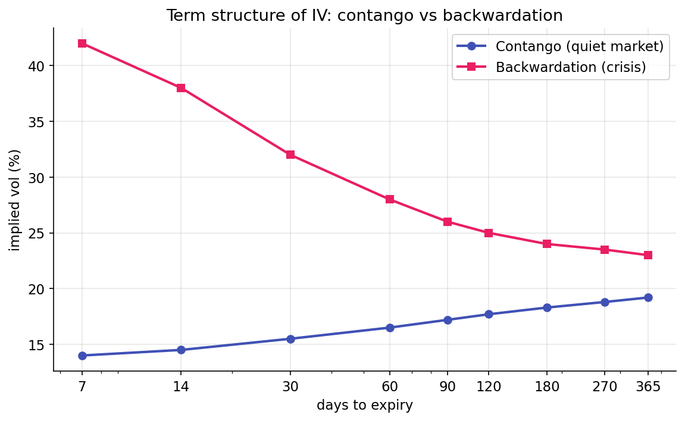

# Across horizons

*Across the horizons the market shapes itself. A line through time. Today is steep. Tomorrow — who knows. We call the shape term structure.*

A single implied-volatility number is insufficient: no single $\sigma$ prices the entire options chain, because options at different expiries trade at different IVs. The pattern of IV across expiries is the **term structure**, and its slope is one of the most reliable regime signals available in options markets.

## Plotting the curve

Pull ATM IVs across expiries (1 week, 2 weeks, 1 month, 3 months, 6 months, 1 year) on the S&P 500. In quiet markets, the curve is upward-sloping (contango). In crises, the short end spikes above the long end (backwardation):

{ loading=lazy }

**Contango** is the normal state: longer horizons price higher uncertainty, and the variance risk premium is typically larger in absolute terms over longer expiries. **Backwardation** is a crisis marker: short-term uncertainty becomes high enough that near-dated options trade at higher IV than far-dated ones, because longer horizons carry an implicit belief in mean reversion and thus do not track the short-term spike.

*The slope moves quickly. Mean reversion is slow.*

## The VIX family

CBOE publishes IV indices at specific maturities on the S&P 500:

| Index | Horizon |
|-------|---------|
| VIX9D | 9 days |
| VIX | 30 days |
| VIX3M | 3 months |
| VIX6M | 6 months |

Each uses the model-free variance-swap formula from [the previous lesson](implied-vol.md), scaled to its target horizon. Two most-watched ratios:

- $\text{VIX9D} / \text{VIX}$ — short-end slope. Above 1 indicates intraday panic pricing above 30-day IV.
- $\text{VIX} / \text{VIX3M}$ — medium slope. Above 1 means 30-day IV exceeds 3-month IV, the most commonly referenced backwardation indicator.

In contango, both ratios are below 1. Inversion pushes one or both above 1.

## Inversion as regime signal

*When the short end stands above the long end, dealers are short gamma, realized volatility rises, trends follow through more often. The inversion is the footprint of panic-hedging flow.*

Empirically, inverted term structure correlates with:

- Short-gamma dealer positioning (Part V) — the hedging feedback loop that amplifies moves.
- Higher realized volatility in the following days.
- Lower mean-reversion — trends that would normally reverse show more follow-through.

The underlying mechanism: demand for short-dated protection (puts expiring this week) is most elastic during acute stress. Customers buy puts; dealers sell them; the implied vol on those puts rises sharply, inverting the short end. The long end moves less — buyers do not panic-hedge year-out exposure — and the slope flips.

The signal is noisy. VIX/VIX3M occasionally crosses 1.0 on minor blips and reverts within hours. The persistence matters as much as the presence.

## Thresholds and noise tolerance

A raw threshold at exactly 1.0 is noisy: small rounding errors, stale data, and intraday feed synchronization issues can push a ratio fractionally above 1.0 without a meaningful regime change. A small buffer reduces false triggers:

$$
\text{is\_inverted} \;=\; \text{short\_slope} > 1.02 \;\; \text{or} \;\; \text{med\_slope} > 1.02.
$$

*A 2% cushion. Not a theoretical number. A calibration. On a cleaner data source one might drop to 1.01; on a noisier one, raise to 1.03. The value sits above unity by enough to ignore measurement error, below the stress-signal levels.*

## Rolling z-scores

Absolute slope levels are not the only useful signal. "The short end is inverted" is one observation; "the short end inverted for the first time in six months" is a different, often sharper, signal. A rolling z-score captures the second form:

$$
z_t = \frac{\text{slope}_t - \bar{\text{slope}}_\text{252d}}{\sigma_\text{slope, 252d}}.
$$

A large positive $z$ indicates the slope is unusually high relative to its trailing year, which can flag regime shifts before the raw threshold is crossed.

## Term structure versus VIX level

*VIX high and contango — elevated volatility expected to persist. Still ordered.*

*VIX high and inverted — acute short-term stress, expected to mean-revert. The shape says what the level cannot.*

Both observations matter in practice. The regime classifier uses shape (inversion) as a trigger for the `vol_inverted` regime; level is not an explicit trigger but indirectly affects position sizing in any strategy that scales by vol.

## The full surface

*Term structure is one axis. The other is strike. IV also varies across strikes at a single expiry. We call that skew. Both are departures from Black-Scholes' constant-$\sigma$ assumption. Both are tradable.*

The trading project consumes two summary statistics from term structure: the two slopes and the inversion flag. The full surface contains additional information, but the regime classifier is intentionally simple.

## Summary

- A single "IV" number conceals surface structure; slope across expiries can carry the signal when the level does not.
- Contango is the normal state; backwardation correlates with short-gamma regimes and high realized volatility.
- Thresholds like 1.02 appear in regime rules because noise tolerance is a calibration decision.

## Implemented at

`trading/packages/gex/src/gex/termstructure.py`:

- Line 23: `compute_term_structure(vix9d, vix, vix3m)` returns the two slopes and inversion flag for a single EOD snapshot.
- Line 39: `rolling_inversion_flags(series, lookback_days=252)` builds the ratios across history with 252-day rolling z-scores. Output columns: `short_slope`, `med_slope`, `short_slope_z`, `med_slope_z`, `is_inverted`.

`regime.py::classify_regime` consumes these via `short_slope` and `med_slope` and uses a 1.02 inversion threshold to trigger the `vol_inverted` regime tag.

---

*Across horizons, the market shapes. Across strikes, it does too — asymmetrically. Next: the skew.*

**Next:** [Fear is not symmetric →](skew.md)
